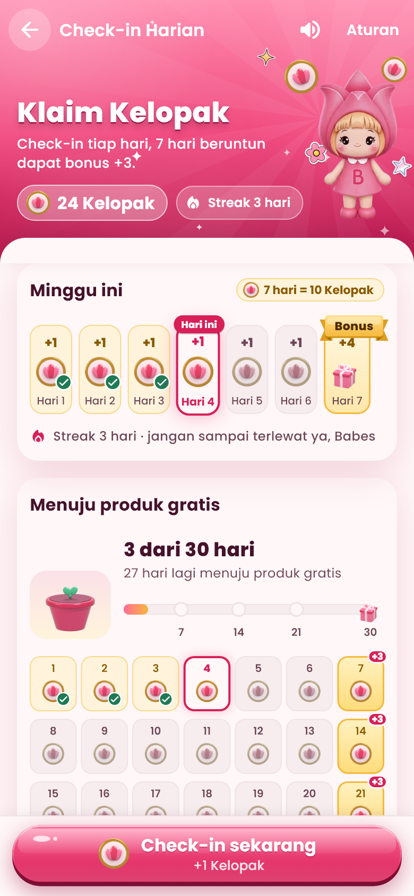
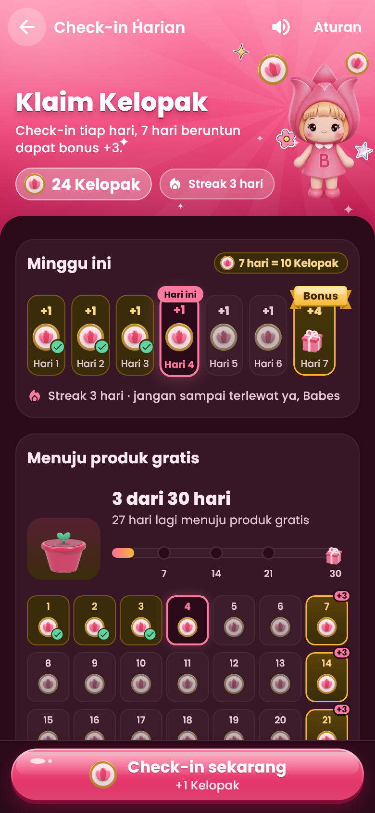
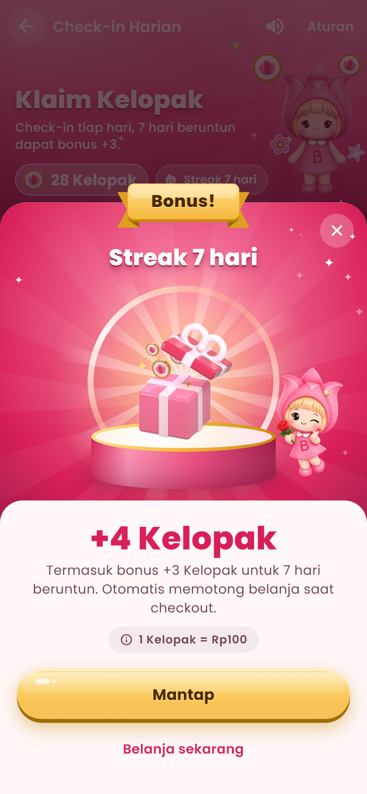
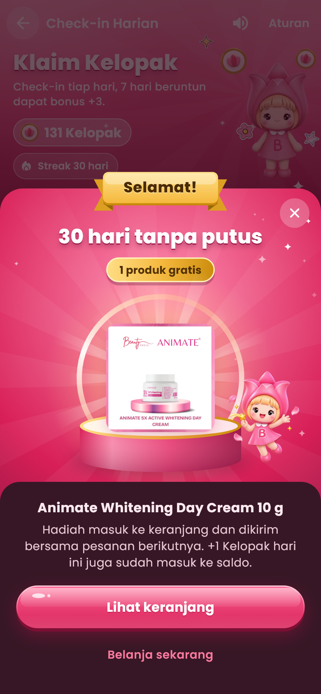

# daily_checkin · Check-in Harian v3 (Bpedia Demo)

Halaman game Check-in Harian siap pakai beserta aturan murninya. +1 Kelopak per tanggal WIB, bonus +3 tiap hari ke-7 beruntun, 1 produk gratis tiap hari ke-30. Bipy bergerak, koin terbang ke saldo, konfeti, tulip tumbuh, dan lembar hasil berpodium. Hanya bergantung pada Flutter SDK.

| Siap klaim | Gelap | Hasil bonus | Hari ke-30 |
|---|---|---|---|
|  |  |  |  |

Lembar animasi klaim (12 bingkai, 130 ms): `docs/shots/klaim_biasa_strip.png`. Halaman penuh: `halaman_siap_panjang_terang.png`, `halaman_hari30_panjang_gelap.png`. Tamu: `halaman_tamu_terang.png`. Teks 200% di lebar 360: `halaman_teks200.png`. Panel uji contoh: `contoh_panel_uji.png`.

## Pasang

```yaml
dependencies:
  daily_checkin:
    path: ../bpedia-daily-checkin
```

Aset (`assets/bipy/`, `assets/art/`, `assets/fx/`) ikut paket dan dirujuk dengan `package: daily_checkin`. Font mengikuti tema host (Bpedia memakai Poppins).

## Pakai

Pola: aturan murni → `CheckInViewState` tak-berubah → `CheckInController` abstrak → `CheckInPage`. Host mengisi satu pengendali; halaman tidak tahu data datang dari mana.

```dart
class HubCheckInController extends CheckInController {
  @override
  CheckInViewState get state => CheckInViewState.fromProgress(
        today: wibDayOf(clock.now()),
        lastClaimDay: store.lastClaimDay,
        storedStreak: store.streak,
        balance: wallet.balance,
        signedIn: auth.isLoggedIn,
        nextResetAt: nextWibMidnight(),
        rewardProduct: const CheckInRewardProduct(
          code: 'P39A06S01000089',
          name: 'Animate Whitening Day Cream 10 g',
          image: AssetImage('assets/catalog/img/P39A06S01000089-1.webp'),
          price: 19900,
        ),
        soundOn: settings.soundOn,
      );

  @override
  Future<CheckInClaimResult?> claim() async { /* kirim, simpan, notifyListeners() */ }
  // refresh, openLogin, openShop, openCart, openProduct, openTerms, playCue, setSoundOn
}

Navigator.push(context, MaterialPageRoute<void>(
  builder: (_) => CheckInPage(controller: controller),
));
```

Untuk contoh dan tes: `LocalCheckInController(clock: ..., streak: 3, balance: 24, rewardProduct: ...)`.

## API

| Simbol | Ringkas |
|---|---|
| `CheckInPage({required CheckInController controller, VoidCallback? onBack, bool showResultSheet = true})` | Halaman lengkap. `CheckInPage.primaryButtonKey` = kunci tombol utama. |
| `abstract class CheckInController extends ChangeNotifier` | `CheckInViewState get state`, `DateTime now()`, `Future<void> refresh()`, `Future<CheckInClaimResult?> claim()` (null bila sudah klaim atau tamu; lempar bila gagal), `openLogin()`, `openShop()`, `openCart()`, `openProduct(String code)`, `openTerms()`, `playCue(GameCue cue)`, `setSoundOn(bool value)`. |
| `CheckInViewState({required signedIn, required balance, required streak, required claimedToday, nextResetAt, rewardProduct, soundOn, busy = false})` | Juga `.guest({rewardProduct, soundOn})` dan `.fromProgress({required today, required lastClaimDay, required storedStreak, required balance, ...})`. Turunan: `weekFilled`, `monthDay`, `monthCycleStart`, `todayStreakDay`, `todayKelopak`, `todayIsBonus`, `todayGrantsProduct`, `daysToBonus`, `daysToProduct`, `copyWith`. |
| `CheckInRewardProduct({required code, required name, required image, required price, strikePrice})` | Data tampilan produk hari ke-30. |
| `CheckInClaimResult({required award, required balance, product})` | Hasil klaim: `CheckInAward` dari aturan murni, saldo baru, produk bila menang. |
| `LocalCheckInController` | Memori: `advanceDays`, `seed`, `reset`, `signedIn`, `rewardProduct`, `latency`, `failNextClaim`, `actions`, `productsWon`. |
| `GameCue` | Isyarat suara: `tap`, `claim`, `bonus`, `winProduct`, `softError` (dipakai halaman ini). |
| Widget | `CheckInWeekStrip`, `CheckInMonthGrid`, `CheckInMonthProgress`, `TulipPot`, `CheckInRewardCard`, `CheckInHowTo`, `showCheckInRulesSheet`, `LivelyPose`. |
| Aset | `CheckInArt` (koin, kado, kalender, tulip 1–5, pose Bipy, stiker), `CheckInSprites.idle` / `.jump`. |
| Format | `formatRupiah`, `countdownClock`, `countdownSpoken`, `streakMessage`, `weekTileSemantics`. |
| Aturan murni (tetap dari v2) | `CheckInRules`, `evaluateCheckIn`, `CheckInAward`, `liveStreak`, `isClaimedOn`, `filledInWeek`, `dayInMonthCycle`, `wibDayOf`, `wibWeekdayOf`, `wibDateOf`. |

## Perilaku

- Tamu melihat halaman utuh; tombol utama "Masuk untuk check-in" dan chip saldo memanggil `openLogin`.
- Sudah klaim: tombol "Kembali besok" nonaktif dengan hitung mundur ke 00.00 WIB; saat lewat tengah malam halaman memanggil `refresh()`.
- Kurangi gerak (`MediaQuery.disableAnimations`) mematikan denyut, stempel, koin terbang, gerak Bipy, dan gulir animasi.
- Teks tahan skala 200% di lebar 360 (diuji terang dan gelap).

## Contoh

```bash
cd example
flutter pub get
flutter run
```

Tombol kembali di contoh membuka **Panel uji**: besok / lompat 2 hari, susun streak (0, 3, 6, 13, 20, 29, 34), masuk/tamu, produk host, jaringan lambat, gagalkan klaim, tema gelap, kurangi gerak, catatan aksi, atur ulang.

## Server

`server/checkin.php` mencerminkan aturan yang sama dan menyediakan `claimDay(array &$state, int $today): string`.

## Perintah

```bash
flutter analyze
flutter test --concurrency=3            # semua tes
flutter test --concurrency=3 test/shots # tangkapan layar ke build/shots/
php server/checkin.php                  # swa-uji aturan server
```

Dokumen: `PRD.md` (produk v3), `CHANGELOG.md`, `PROGRESS-M1.md` (catatan pembangunan).
